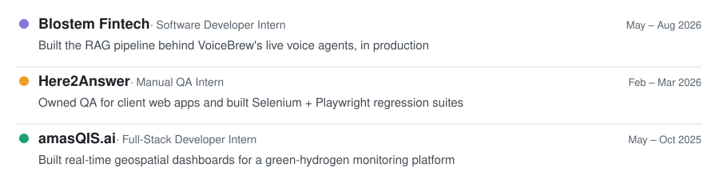

<picture>
  <source media="(prefers-color-scheme: dark)" srcset="assets/bento-dark.svg">
  
</picture>

### Selected work

  
  
  
  

### Experience

  <a href="mailto:sameendhanimisetti@gmail.com">Email</a> ·
  <a href="https://www.linkedin.com/in/sameen-dhanimisetti-5a8936278/">LinkedIn</a> ·
  <a href="assets/Sameen_Dhanimisetti_Resume.pdf">Resume</a>

